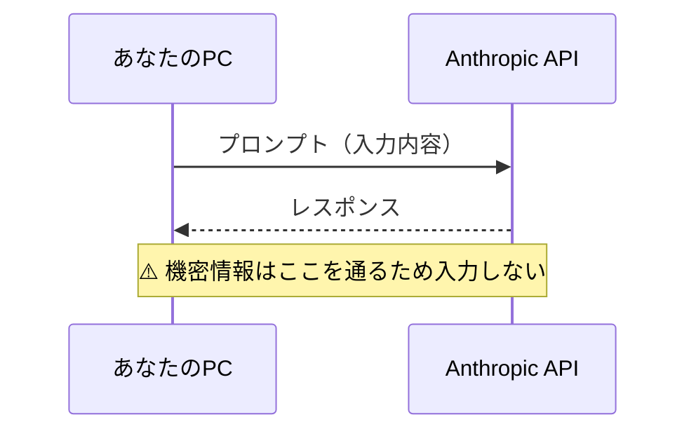
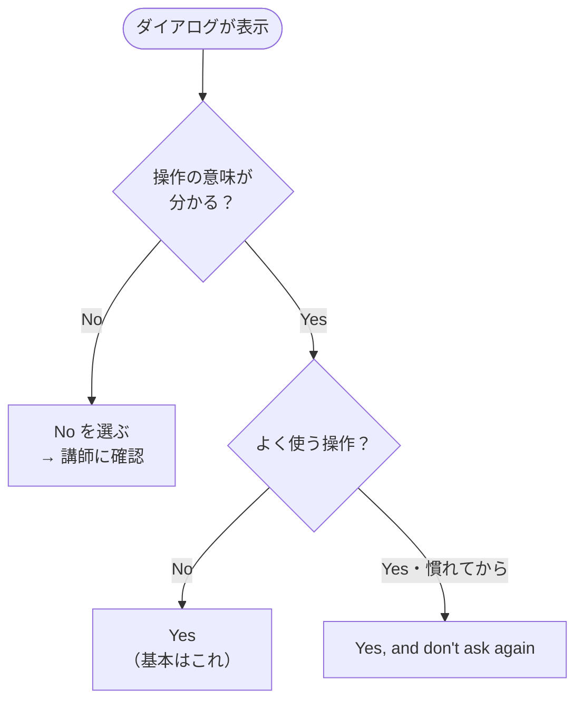
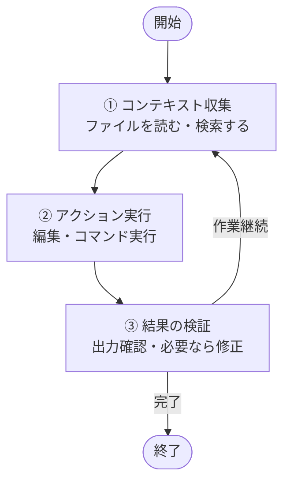
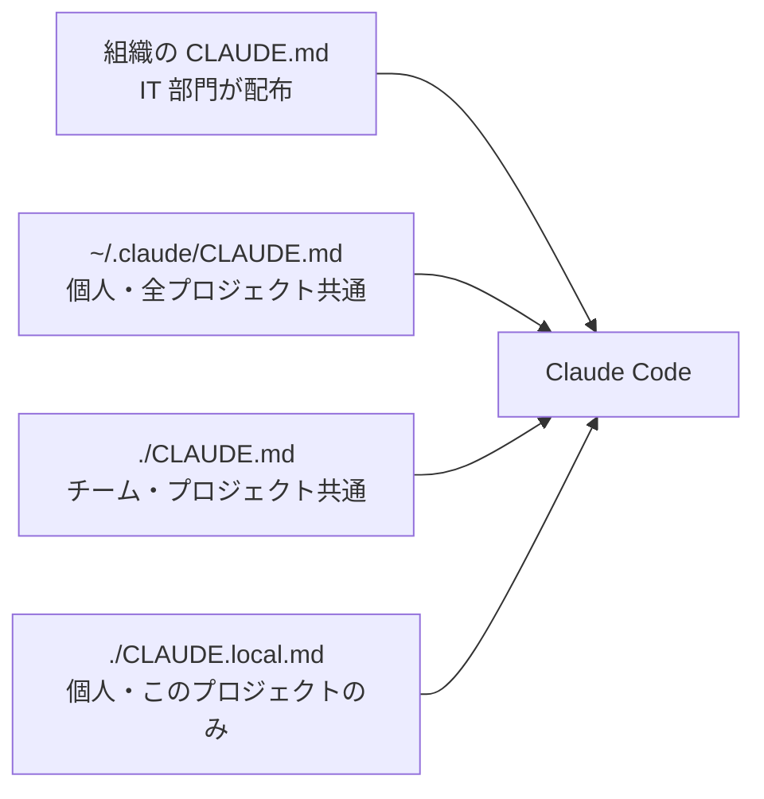
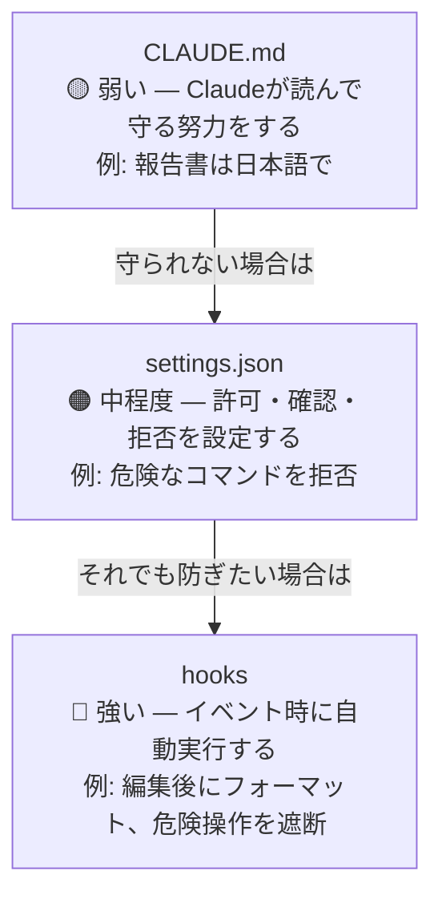
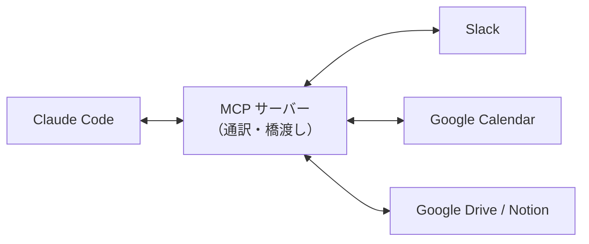

# Claude Code 法人向けハンズオン研修

> - **研修時間**: 合計 15 時間（5 時間 × 3 回）
> - **対象者**: 生成 AI を業務に活用したい企業の社員
> - **前提条件**: Windows または Mac のパソコン。社内手続きに従い Claude（Anthropic）の利用が可能なこと。研修開始までに下記「事前準備」を済ませ、`claude` と入力して Claude Code が起動する状態であること
> - **情報の確認日**: 2026 年 10 月 25 日（Claude Code v2.1.310 時点の[公式ドキュメント](https://code.claude.com/docs/ja/overview)で確認）。Claude Code は毎週のように更新されるため、研修前に[変更履歴](https://code.claude.com/docs/en/changelog)と付録 D を確認してください

---

## この研修でできるようになること

本研修では、Claude Code を使って業務ファイルの作成・整理・改善を安全に進める方法を学びます。

終了時には、以下ができる状態を目指します。

1. Claude Code が何であるか、普通のチャット AI との違いを説明できる
2. 法人利用で守るべきセキュリティ境界と権限モードを理解し、安全に使える
3. ファイル作成・読取・編集・コマンド実行を自分で体験できる
4. CLAUDE.md、settings、Skills、Agents（サブエージェント）、Hooks、MCP、プラグインの役割を理解できる
5. 業務秘書エージェントを部署・チームの試験運用に合わせて立ち上げられる
6. 議事録整理、文書作成、業務改善の場面で実務に近い使い方を設計できる
7. 研修後 1 週間の定着計画を作り、継続利用に移れる

## 15 時間カリキュラム全体像

| セッション | タイトル | 時間 | 到達目標 |
|---|---|---:|---|
| Session 1 | Claude Code の概要と基本操作 | 5 時間 | 安全ルールを理解し、ファイル作成・読取・編集を完走する |
| Session 2 | 自社標準化と業務秘書エージェント | 5 時間 | 共通ルールと設定を理解し、部署で試せる秘書運用を立ち上げる |
| Session 3 | 業務活用ワークショップと定着計画 | 5 時間 | 実務ユースケースに適用し、研修後の運用計画を作る |

### 必須と発展

| セッション | Minimum | Advanced |
|---|---|---|
| Session 1 | 起動、安全ルール、停止方法、ファイル操作を完走する | 議事録要約と差分確認まで行う |
| Session 2 | チーム共通 CLAUDE.md 作成、部署タスク追加、日次確認を行う | settings、Agents、Hooks、週次レビュー運用を設計する |
| Session 3 | 業務ワークを 1 つ完走し、1 週間計画を作る | チーム展開用の共有ルール案と運用チェックリストを作る |

---

## 事前準備

この章では、Claude Code が起動できる状態にするまでの手順を進めます。基本動作は次の 2 つだけです。

1. 画面に表示された **英数字のかたまり（コマンド）を、そのままコピーして貼り付け、Enter（Return）キーを押す**
2. 表示された指示に従い、**サインイン** する

分からないときは、まず社内の IT 部門または研修講師に相談してください。

次の表は本章で出てくる用語のイメージです。

| 用語 | イメージ |
|---|---|
| ターミナル | 文字だけでパソコンへ指示を出す窓。Windows では **PowerShell**、Mac では **ターミナル** アプリを使います |
| Claude Code | そのターミナル上で動く AI の作業支援ツール。起動すると「指示を入力できる画面」になります |
| 公式ドキュメント | 開発元（Anthropic）が公開している手順書。[クイックスタート（日本語）](https://code.claude.com/docs/ja/quickstart) に、インストールの詳細や別の方法があります。ターミナルを初めて使う場合は公式の[ターミナルガイド](https://code.claude.com/docs/ja/terminal-guide)も参考になります |

**この資料どおりに入れる場合、あらかじめ Node.js をインストールする必要はありません。** 公式が推奨する「ネイティブインストール」（下の `curl` または PowerShell の 1 行）が、必要なプログラムをまとめて用意します。ネイティブインストールは **バックグラウンドで自動更新** されます。

一方で **`npm install -g @anthropic-ai/claude-code` で入れる方法** も公式に残っており、その場合は **Node.js 22 以上** が条件です（[高度なセットアップ](https://code.claude.com/docs/ja/setup)）。社内で「npm 経由のみ可」と決まっているときは IT 部門の指示に従ってください。いずれの入れ方でも、公式の説明では **動いている `claude` 本体は実行時に Node を呼び出さない** ネイティブバイナリです。

**動作環境の目安**（[高度なセットアップ](https://code.claude.com/docs/ja/setup)）: macOS 13.0 以上、Windows 10 1809 以上（または Windows Server 2019 以上）、メモリ 4 GB 以上。

### 受講者の準備（研修の 1 週間前まで）

#### 0. 社内ルールの確認（必須）

> [!CAUTION]
> 社外秘・個人情報・未公開情報を Claude Code に入力してはいけません。社内規程を必ず確認してから次の手順に進んでください。

社内規程に従い、**外部の AI に入力してよい情報・してはいけない情報** を確認してください。不明な場合は上司または IT 部門に聞いてから進めます。

> [!NOTE]
> 「何を入力しても大丈夫ですか？」と迷ったら、入力しない選択が安全です。社内で判断基準が示されるまで待ちましょう。

#### 1. アカウントの準備（必須）

Claude Code を使うには、次のいずれかに相当するアカウントが必要です。 **会社の手続き（利用申請・課金）に従って** ください。

- [Claude の料金プラン](https://claude.com/pricing)（Pro / Max / Team / Enterprise）でサインインできる状態（公式の推奨）
- または [Claude Console](https://platform.claude.com/)（旧 Anthropic Console）のアカウント（API 利用・前払いクレジット）
- または社内で指定されているクラウド経由の利用（Amazon Bedrock、Google Cloud の Agent Platform（旧 Vertex AI）、Microsoft Foundry など）
- または社内で運用している Claude apps gateway（管理者が設定している場合は、`/login` で社内 SSO を使ってサインインします）

詳細は公式の [クイックスタート「始める前に」](https://code.claude.com/docs/ja/quickstart) を参照してください。

> [!IMPORTANT]
> 個人向けプラン（Free / Pro / Max）と法人向け契約（Team / Enterprise / API など）では、**入力データの学習利用や保存期間の扱いが異なります**（Session 1 §3 参照）。業務で使う場合は、会社が契約した法人向けアカウントを使うのが原則です。

#### 2. ターミナルを開く

- **Windows**  
  スタートメニューで「PowerShell」と入力し、**Windows PowerShell** を開きます。  
  （会社の PC で別の名前の端末アプリを使うよう決まっている場合は、その指示に従ってください。）
- **Mac**  
  **Spotlight 検索**（Command + スペース）で「ターミナル」と入力し、**ターミナル** を開きます。

#### 3. Claude Code をインストールする（お使いの OS で 1 回だけ）

次の **いずれか 1 つ** を実行します。コマンドは **行ごとまるごとコピー** して、ターミナルに貼り付けて Enter を押してください。

**Mac、または Linux / WSL を使う場合（公式が推奨する入れ方）**

```bash
curl -fsSL https://claude.ai/install.sh | bash
```

**Windows（PowerShell を開いた状態で）**

```powershell
irm https://claude.ai/install.ps1 | iex
```

**Windows（コマンドプロンプト（CMD）を使う場合）**

```text
curl -fsSL https://claude.ai/install.cmd -o install.cmd && install.cmd && del install.cmd
```

> [!TIP]
> Windows では、行頭が `PS C:\` なら PowerShell、`C:\`（`PS` なし）なら CMD です。`'irm' is not recognized` と出たら CMD、`The token '&&' is not a valid statement separator` と出たら PowerShell で実行しています。対応するほうのコマンドを使ってください。

インストール中は進行状況が表示されません。終わったら **ターミナルを開き直して** から次の動作確認に進みます。実行中に「続行しますか」などと聞かれたら、画面の案内に従って許可します。 **会社の PC で弾かれる場合は、自分で無理に許可せず、IT 部門に依頼** してください。

> [!NOTE]
> Windows では以前 Git for Windows が必須でしたが、現在は **必須ではありません**。入っていない場合、Claude Code はコマンド実行に PowerShell を使います（Git for Windows は引き続き推奨）。

**補足（上級者・社内標準向け）**  
Homebrew（`brew install --cask claude-code`）や WinGet（`winget install Anthropic.ClaudeCode`）、Linux の apt / dnf / apk で入れる方法も公式にあります。これらは **自動更新されない** ため、定期的に手動で更新します。一覧は [クイックスタートの「ステップ 1」](https://code.claude.com/docs/ja/quickstart) を参照してください。社内で「必ずこの方法で」と決まっている場合は **社内手順を優先** してください。

#### 4. 動作確認

ターミナルで、次を **1 行ずつ** 実行します。

```bash
claude --version
```

**出力の例**（バージョン番号の並びは環境ごとに異なります）

```text
2.1.310 (Claude Code)
```

数字の並びが違っても問題ありません。**`Claude Code` の文字列や、ピリオドで区切られたバージョンらしき数字**が含まれていれば、コマンドが認識できています。

続けて起動の確認をします。

```bash
claude
```

- 初回はブラウザが開き、**サインイン** を求められることがあります。画面の指示に従って完了させ、ターミナルに戻ります。
- すでにサインイン済みの場合は、そのまま Claude Code の入力画面になることがあります。

**期待される状態**

- `claude --version` で、上記の例のように **バージョン情報が 1 行以上** 表示される
- `claude` で Claude Code の入力欄が開き、文字を打てる

うまくいかない場合は、[インストールのトラブルシューティング（日本語）](https://code.claude.com/docs/ja/troubleshoot-install) を開き、手順どおり試すか、IT 部門・講師に相談してください。起動できる状態なら、ターミナルで `claude doctor` を実行すると、インストールや自動更新の状態を確認できます。

なお、公式では **ターミナル以外の入り方** も案内されています（[プラットフォームと連携](https://code.claude.com/docs/ja/platforms)）。

| 入り方 | 特徴 |
|---|---|
| デスクトップアプリ（Claude アプリの **Code** タブ） | ターミナルを使わずに、画面上で変更内容を確認しながら作業できる。Pro / Max / Team / Enterprise のサブスクリプションが必要（[デスクトップのクイックスタート](https://code.claude.com/docs/ja/desktop-quickstart)） |
| VS Code / JetBrains の拡張機能 | エディター内で差分を見ながら使える |
| Web（[claude.ai/code](https://claude.ai/code)）・モバイルアプリ | クラウド上で実行する。手元の PC を閉じても作業が続く |

本研修の手順は **ターミナル版** に限定します。設定・CLAUDE.md・MCP などは、手元の PC で使う各入り方の間で共有されます。

---

## Session 1 — Claude Code の概要と基本操作

> **時間**: 5 時間
> **ゴール**: Claude Code の概要、法人利用の安全境界、起動方法、ファイル操作、エージェントループを理解する

### Session 1 の到達目標

受講者は Session 1 終了時点で、以下ができるようになります。

- Claude Code とチャット AI の違いを説明できる
- 法人利用で入力してよい情報・入力してはいけない情報を判断できる
- `claude` を起動し、最初の対話ができる
- 権限モード（Manual / auto など）の違いを説明し、今どのモードかを確認できる
- 許可ダイアログで `Yes`、`Yes, and don't ask again`、`No` を選び分けられる
- 困った時に `Esc` や `/exit` で止め、`/rewind` で巻き戻せる
- ファイル作成、読取、追記、修正を実行できる
- エージェントループの基本を説明できる

### タイムテーブル

| 時間 | 内容 | 形式 |
|---|---|---|
| 0:00–0:20 | オープニング、研修全体像 | 講義 |
| 0:20–0:55 | Claude Code とは何か、なぜ企業で学ぶのか | 講義・対話 |
| 0:55–1:35 | 法人利用の安全ルール | 講義 |
| 1:35–1:45 | 休憩 | - |
| 1:45–2:30 | Claude Code の起動と初回対話 | 実習 |
| 2:30–3:05 | 権限モード、許可ダイアログ、停止方法 | 実習 |
| 3:05–3:35 | チェックポイント、エージェントループ | 講義 |
| 3:35–3:45 | 休憩 | - |
| 3:45–4:40 | ファイル作成・読取・編集 | 実習 |
| 4:40–5:00 | 振り返り、フォロー | 共有 |

### 1. Claude Code とは

Claude Code は、PC のターミナル上で動く AI エージェントです。普通のチャット AI が「文章で答える」ことを中心にするのに対し、Claude Code はファイルを読み、書き、編集し、コマンドを実行しながら作業を進めます。

|  | 普通のチャット AI | Claude Code |
|---|---|---|
| 動作環境 | ブラウザ | PC のターミナル（デスクトップアプリ・IDE・Web 版もあり） |
| 主な使い方 | 相談、文章生成 | ファイル操作、作業実行、検証 |
| できること | 回答を返す | 読む、書く、直す、実行する |
| 育て方 | 毎回プロンプトを書く | 設定ファイルやスキルで継続的に育てる |

#### 「答える」から「動く」へ — 従来型 AI との違い

従来型のチャット AI が「答えを返す」ところで止まるのに対し、Claude Code のような **AI エージェント** は、目標を伝えると「収集 → 計画 → 実行 → 検証 → 改善」を自律的に進めます。4 つの観点で整理すると違いが明確になります。

| 観点 | 従来型 AI（チャット） | AI エージェント（Claude Code） |
|---|---|---|
| **入力** | 1 問 1 答の質問 | 目標・ゴール |
| **動作** | 回答を返す | データ収集 → 計画 → 実行 → 検証 → 改善 |
| **ツール** | なし／限定的 | ファイル操作・コマンド実行・外部サービス連携など |
| **人間の役割** | 都度、細かく指示する | 最終承認・境界の設計に集中する |

> [!TIP]
> 覚え方のたとえ: 従来型 AI は **賢い検索エンジン**（知りたいことを教えてくれる）、AI エージェントは **優秀な部下**（目的を伝えれば自分で動いて仕上げる）に近いと言えます。任せ方が変わるため、プロンプトの書き方だけでなく **何を任せ、どこで止めるか**（§3 の安全ルールや §6 の権限モード・許可ダイアログ）の設計が重要になります。この自律的な動きの仕組みは §9「エージェントループ」で扱います。

### 2. なぜ企業で学ぶのか

企業で Claude Code を学ぶ理由は、AI を「相談相手」から「作業の共同実行者」に変えるためです。

例

- 議事録から決定事項とアクションアイテムを抽出する
- 週報や報告書のドラフトを作る
- 社内マニュアルを読みやすく整理する
- フォルダ内の資料を読み、差分や論点をまとめる
- タスク管理の仕組みを自分の業務に合わせて作る

重要なのは、最初から完璧な自動化を狙わないことです。Session 1 のゴールは、明日から 1 つの作業を Claude Code に任せてみるための土台を作ることです。

> [!NOTE]
> 2026 年春の 6 カ国比較調査では、日本企業の生成 AI 活用・推進度は 87% に達しました。一方、効果が「期待を大きく上回る」と答えた割合は日本が 9% と 6 カ国で最も低く（米国は 38%）、導入から「効果創出」への移行が課題になっています（[PwC Japan 生成AIに関する実態調査2026 春 6カ国比較](https://www.pwc.com/jp/ja/knowledge/thoughtleadership/generative-ai-survey2026.html)、日本の回答者は売上高 500 億円以上の企業の課長職以上 932 名）。

### 3. 法人利用の安全ルール

Claude Code はローカル PC 上で動作しますが、プロンプトとレスポンス（Claude が読んだファイルの内容を含む）は Anthropic の API を経由します（[セキュリティ](https://code.claude.com/docs/ja/security) / [データの使用](https://code.claude.com/docs/ja/data-usage) / [プライバシーポリシー](https://www.anthropic.com/legal/privacy)）。法人利用では、便利さより先に情報の境界線を決めます。

#### 入力してよい情報

- 研修用のダミーデータ
- 公開済み情報
- 個人名や会社名を伏せた業務例
- 社内ルール上、外部 AI 利用が許可された文書

#### 入力してはいけない情報

> [!CAUTION]
> 以下の情報は外部 AI へ送信してはいけません。誤って入力した場合は、社内のセキュリティ担当へ速やかに報告してください。

- 個人情報
- 顧客名、契約金額、未公開案件
- 機密指定された資料
- API キー、パスワード、アクセストークン
- 就業規則など社内規程で外部利用が制限される情報

> [!NOTE]
> 参考: IPA（情報処理推進機構）の[テキスト生成AI導入・運用ガイドライン](https://www.ipa.go.jp/jinzai/ics/core_human_resource/final_project/2024/generative-ai-guideline.html)では、企業における生成AI利用の情報管理指針が示されています。

#### ダミーデータ化の例

| 元データ | 置き換え例 |
|---|---|
| 株式会社ABC | クライアントA |
| 田中太郎 | 担当者A |
| 1,250万円 | 約1,000万円 |
| 新製品Xの未公開価格 | 新サービスの価格 |

#### 情報の流れ

プロンプトとレスポンスは Anthropic の API を経由します。この経路を意識することが、安全な利用の基本です。



#### データの扱い（公式ドキュメントより）

| 項目 | 個人向けプラン（Free / Pro / Max） | 法人向け（Team / Enterprise / API / クラウド経由） |
|---|---|---|
| モデルの学習への利用 | 本人の設定次第（オンにすると学習に利用される） | 原則として利用されない（顧客が明示的に提供を選んだ場合を除く） |
| Anthropic 側の保存期間 | 学習利用オン: 5 年 / オフ: 30 日 | 標準 30 日（条件を満たす Enterprise 契約ではゼロデータ保持も可） |

あわせて、**手元の PC にも記録が残る** ことを覚えておきます。

- 会話の記録（トランスクリプト）は `~/.claude/projects/` に **平文で 30 日間**（既定）保存され、`/resume` などで使われます
- **自動メモリ**（Session 2 §2）が有効な場合、Claude が「次回以降に役立つ」と判断した内容を `~/.claude/projects/<プロジェクト>/memory/` にメモとして残します
- `/feedback` で送ったフィードバックや、セッション後のアンケートで「Yes」を選んで共有したトランスクリプトは、上記とは別の期間保存されます。業務データを含むセッションでは安易に共有しないでください

> [!NOTE]
> 詳細と最新の条件は [データの使用](https://code.claude.com/docs/ja/data-usage) を確認してください。社内のどの契約・アカウントで使うかは、必ず IT 部門の指示に従います。

### 4. Claude Code を起動する

ターミナルを開きます。

- Windows: PowerShell
- Mac: ターミナル

本研修では、Claude が操作のたびに確認を求める **Manual モード** で起動します（理由は §6 で説明します）。

```bash
claude --permission-mode manual
```

初回はブラウザが立ち上がり、サインイン画面が表示されます。サインイン後、ターミナルに戻ると Claude Code の入力欄が表示されます。入力欄の上にはバージョン、使用中のモデル、作業フォルダが表示されます。

完了の目安

- ターミナル上に Claude Code の入力欄が表示される
- 入力欄の下（ステータス表示）に `⏸ manual mode on` と表示されている
- 文字を入力して送信できる
- Claude から返答が返ってくる

> [!TIP]
> アカウントを切り替えたいときや再サインインが必要なときは、起動後に `/login` と入力します。

### 5. 最初の対話

以下を入力してください。

```text
この研修では、Claude Code を業務で安全に使う方法を学びたいです。
まず、今日の学習ゴールを3つに整理してください。
```

完了の目安

- Claude が 3 つの学習ゴールを返す
- 返答内容を読んで、分からない言葉を追加質問できる

### 6. 権限モードと許可ダイアログ

#### 権限モード — 「どこまで確認なしで動いてよいか」

**権限モード**は、Claude が確認なしで実行してよい範囲を決める設定です。現在のモードは入力欄の下のステータス表示で確認でき、`Shift + Tab` で切り替えられます（[権限モードの選択](https://code.claude.com/docs/ja/permission-modes)）。

| モード | 確認なしで動く範囲 | 向いている場面 |
|---|---|---|
| **Manual**（設定値は `default`） | 読み取りのみ。編集・コマンド実行は毎回確認する | 研修・機密性の高い作業。**本研修の基本** |
| `acceptEdits` | 読み取り、ファイル編集、`mkdir` など一般的なファイル操作 | 内容を確認しながら編集を進めたいとき |
| `plan` | 読み取りと調査のみ。計画を承認するまで編集しない | 大きな作業の前（Session 2 §7） |
| **auto** | ほぼすべて。別の AI（分類器）が裏で安全性をチェックする | 長い作業で確認の手間を減らしたいとき |

このほか `dontAsk`（自動処理向け）と `bypassPermissions`（隔離環境専用。すべて確認なし）がありますが、本研修では使いません。

> [!IMPORTANT]
> **Claude Code v2.1.283（2026 年 9 月）以降、何も設定していなければ、ターミナルと VS Code のセッションは auto モードで始まります。** auto モードでは許可ダイアログがほとんど出ず、分類器が「依頼の範囲を超える操作」「外部への機密データ送信」「本番環境への反映」などをブロックします。ただし公式も **「安全を保証するものではない」** と明記しています。研修では操作の中身を自分の目で確かめるため、§4 のとおり `claude --permission-mode manual` で起動します。
>
> 起動後に auto モードになっている場合は、`Shift + Tab` を 1 回押すと Manual モード（`⏸ manual mode on`）に切り替わります。毎回 Manual で始めたい場合は、`~/.claude/settings.json` に `"permissions": { "defaultMode": "manual" }` を書くか、組織の managed settings で既定値を配布します（Session 2 §6）。組織によっては auto モード自体が無効化されています。

#### 許可ダイアログ

Manual モードでは、Claude Code がファイル編集やコマンド実行を行う時、次のような許可ダイアログが表示されます。

| 選択肢 | 意味 | この段階での目安 |
|---|---|---|
| `Yes` | 今回だけ許可 | 基本はこれ |
| `Yes, and don't ask again …` | 同じ操作を以後は確認なしで許可（コマンドはこのプロジェクトで永続、ファイル編集はセッション終了まで） | 頻出操作だけ慣れてから検討 |
| `Yes, and switch to auto mode` | 許可して auto モードへ切り替える（表示されない場合もある） | 研修中は選ばない |
| `No`（または `Esc`） | 拒否。Claude はその操作をせずに止まる | 意図しない操作なら選ぶ |

初回は、基本的に `Yes` を選びます。意味が分からない操作が出たら、許可せず講師に確認してください。`Yes` または `No` を選んだ状態で `Tab` を押すと、「ここは〜してほしい」といったコメントを添えて Claude に伝えられます。



> [!NOTE]
> 「Yes, and don't ask again」で保存されたコマンドの許可ルールは `.claude/settings.local.json` に書き込まれます。あとから見直したり削除したりするときは `/permissions` を使います。

### 7. 止め方を覚える

AI を安全に使うために、始め方より先に止め方を覚えます。

| 操作 | 使う場面 |
|---|---|
| `Esc` | 実行中の作業を止めたい（それまでの作業は残る）。許可ダイアログでは「No」と同じ |
| `Esc` 2 回（入力欄が空のとき） | 巻き戻しメニューを開き、以前の状態に戻したい（入力欄に文字があると、まず入力内容が消去される） |
| `/rewind` | `Esc` 2 回と同じ巻き戻しメニューを開く |
| `/exit`（または `Ctrl + D` を 2 回） | セッションを終了したい |

### 8. チェックポイント

Claude Code は、あなたがプロンプトを送るたびに**チェックポイント**を作成し、Claude によるファイル編集を記録します。§7 の `Esc` 2 回または `/rewind` で巻き戻しメニューを開き、戻したい時点を選ぶと次の操作ができます（[チェックポイント](https://code.claude.com/docs/ja/checkpointing)）。

| メニュー | 動作 |
|---|---|
| Restore code and conversation | ファイルと会話の両方をその時点に戻す |
| Restore conversation | 会話だけ戻し、ファイルは今のまま |
| Restore code | ファイルだけ戻し、会話は今のまま |
| Summarize from here / up to here | その時点以降（以前）の会話を要約してコンテキストを空ける（ファイルは変わらない） |

ポイント

- ファイル編集の失敗を戻したい時に使う
- チェックポイントはセッションを閉じても残り、`/resume` で再開した後でも巻き戻せる（既定で約 30 日保存）
- Claude がコマンド（Bash など）だけで変更したファイルや、外部システムへの操作・送信済みの内容は戻せない
- 重要な業務ファイルを扱う時は、作業前にコピーを残しておく（Git などのバージョン管理があればなお良い）

### 9. エージェントループとは

Claude Code は、目的に向かって以下の流れを繰り返します。



普通のチャット AI は「質問に答える」だけで止まります。Claude Code は、作業が終わるまで次の手を考えます。ただし、あなたもループの一部です。途中で止める、方向修正する、許可しない、という判断を必ず行います。

### 10. 作業フォルダを用意する

研修用フォルダを作り、その中で Claude Code を起動します。

```bash
mkdir claude-code-training
cd claude-code-training
claude --permission-mode manual
```

すでにフォルダを作っている場合は、そのフォルダで起動してください。Manual モードでは、Claude は起動したフォルダの外のファイルを読み書きする前に確認を求めます。

### 11. 対話で設計する

いきなりファイルを作らず、まず設計を依頼します。

```text
このフォルダで業務用の自己紹介ファイル about-me.md を作りたいです。
社内向けに、担当業務・得意分野・今取り組んでいるプロジェクトを含む構成案を提案してください。
まだファイルは作らず、構成案だけ出してください。
```

完了の目安

- 構成案が返ってくる
- ファイルはまだ作成されていない
- 「まず設計、その後に作成」という流れを体験できる

### 12. ファイルを作る

構成案を確認したら、ファイル作成を依頼します。

```text
その構成案で about-me.md を作成してください。
内容は研修用のダミーデータで構いません。
```

許可ダイアログが出たら、内容を確認して `Yes` を選びます。

完了の目安

- `about-me.md` が作成される
- ファイル内容を開いて確認できる

### 13. ファイルを読む

```text
about-me.md の内容を読んで、改善できる点を3つ挙げてください。
まだ編集はしないでください。
```

完了の目安

- Claude が既存ファイルを読んでいる
- 改善提案が具体的に返ってくる
- 編集前に確認できる

### 14. ファイルを書き換える

```text
提案のうち、社内向けに分かりやすくする改善だけ反映してください。
変更後に、どこを変えたかを簡単に説明してください。
```

完了の目安

- ファイルが更新される
- 変更内容の説明が返る
- 自分でファイルを開いて確認できる

### 15. 議事録ファイルを作る

次に、業務に近いファイルを扱います。

```text
meeting-memo.txt を作って、以下の内容を書いてください。

日時: 2026年5月1日 14:00
出席者: 田中、佐藤、鈴木
議題: Q2 販売戦略の見直し
決定事項: 来月から週次で進捗確認ミーティングを実施する
担当: 田中
```

続けて、要約を依頼します。

```text
meeting-memo.txt を読んで、決定事項、担当者、次のアクションに分けて整理し、meeting-summary.md として保存してください。
```

完了の目安

- `meeting-memo.txt` と `meeting-summary.md` が作成される
- 元情報と要約の対応関係を確認できる

### Session 1 の復旧手順

| 症状 | 原因候補 | 対応 |
|---|---|---|
| `claude: command not found` | 未インストール、ターミナルを開き直していない、PATH が通っていない | ターミナルを一度閉じて開き直す。それでも出る場合は [インストールのトラブルシューティング（日本語）](https://code.claude.com/docs/ja/troubleshoot-install) に従うか、IT 部門・講師に相談 |
| ブラウザが開かない | 既定ブラウザや社内制限 | 表示された URL を手動で開く |
| サインインできない | アカウント未準備、法人設定不足 | IT 部門または講師に確認 |
| 許可ダイアログが出ずに編集が進む | auto モードや acceptEdits モードで動いている | ステータス表示を確認し、`Shift + Tab` で `⏸ manual mode on` に切り替える。次回から `claude --permission-mode manual` で起動 |
| 許可ダイアログで迷う・不安になる | 操作内容が理解できていない | `No`（または `Esc`）を選んで講師に確認 |
| ファイルが作られない | 依頼文に「保存して」「作成して」がない | 依頼文を具体化する |
| 内容が期待と違う | 編集前確認が不足 | `Esc` 2 回（`/rewind`）で戻し、「まだ編集せず、改善案だけ出して」と依頼し直す |
| 原因がよく分からない不具合 | 設定・インストールの問題 | 起動後に `/doctor` を実行し、診断結果を講師と確認する |

### Session 1 のフォロー

- 自分の業務で「AI に相談したい作業」を 3 つ書き出す
- そのうち、機密情報を含まずに試せる作業を 1 つ選ぶ
- 次回使う作業フォルダを作っておく
- Claude Code に「整理だけ」を依頼し、良かった点と不安・違和感があった点をメモする

---

## Session 2 — 自社標準化と業務秘書エージェント

> **時間**: 5 時間
> **ゴール**: Claude Code を部署・プロジェクトの共通ルールに合わせ、業務秘書エージェントの試験運用を立ち上げる

> [!NOTE]
> Session 1 のエージェントループで出てきた「コンテキスト収集」は、作業に必要な情報を集める手順です。本セッションの「コンテキストウィンドウ」は、AI に一度に渡せるテキスト全体の容量を指します。語は似ていますが、別の概念です。

### Session 2 の到達目標

受講者は Session 2 終了時点で、以下ができるようになります。

- CLAUDE.md の役割を説明し、簡単なルールを書ける。自動メモリとの違いを説明できる
- settings.json が「お願い」ではなく「ガード」であることを理解できる
- Skills、Agents（サブエージェント）、Hooks の違いを説明でき、MCP で外部ツールを、プラグインで機能一式を増やせることを理解できる
- Plan モードと 2 段階パターンで、確認しながら段階的に作業を進められる
- コンテキストウィンドウの考え方と、`/context`・`/compact`・`/clear` の使い分け、Plan モードの使いどころを理解できる
- cc-secretary または手動版秘書を使い、部署で共有できる運用テンプレートを作れる
- 部署の業務カテゴリとタスク管理ルールを設定できる

### タイムテーブル

| 時間 | 内容 | 形式 |
|---|---|---|
| 0:00–0:20 | Session 1 のフォロー共有、安全ルール再確認 | 対話 |
| 0:20–1:00 | CLAUDE.md と設定ファイル | 講義 |
| 1:00–1:45 | CLAUDE.md 作成実習 | 実習 |
| 1:45–1:55 | 休憩 | - |
| 1:55–2:35 | Plan モード、Skills / Agents / Hooks / MCP | 講義 |
| 2:35–3:05 | コンテキスト管理 | 講義 |
| 3:05–3:15 | 休憩 | - |
| 3:15–4:05 | 業務秘書エージェント導入 | 実習 |
| 4:05–4:40 | 基本操作と部署仕様化 | 実習 |
| 4:40–5:00 | つまずき対応、振り返り、フォロー | 共有 |

### 1. 自社標準に合わせるとは

Claude Code は、毎回長いプロンプトを書かなくても、ファイルや設定を通じて振る舞いを変えられます。法人利用では、個人の好みよりも先に、部署・プロジェクトで守る共通ルールを定義します。

例

- 報告書は常にですます調（日本語）で作成する
- ファイル名に顧客名を含めない
- 危険なコマンドは許可しない
- よく使う業務手順を Skills で定型化する
- 専門作業をサブエージェントに任せる

### 2. CLAUDE.md — プロジェクトのメモリ

CLAUDE.md は、Claude Code に対する永続的な指示書です。プロジェクトのルートに置くと、起動時に自動で読み込まれます（[メモリ](https://code.claude.com/docs/ja/memory)）。`/init` を実行すると、Claude がフォルダの中身を調べて CLAUDE.md の雛形を作ってくれます。

```markdown
# プロジェクトルール

- 常に日本語で応答してください
- 報告書は「ですます調」で作成してください
- 機密情報をファイル名やコミットメッセージに含めないでください
- 不明点がある場合は、作業前に確認してください
```

ポイント

- 抽象的な精神論より、具体的で検証可能な指示を書く
- 長すぎると毎回の読み込み負荷になり、守られにくくもなるため、1 ファイル 200 行以内を目安にする
- チーム共通ルールを先に決め、個人ルールは補足として分ける
- 200 行を超えそうなら `.claude/rules/` に用途別で分割する（API 用・テスト用など）
- 特定フォルダだけに効かせるルールは `paths` で対象を限定できる（関係するファイルを扱うまでコンテキストに載らない）
- 他の AI ツール向けの `AGENTS.md` しかないフォルダでは、Claude Code はそれを CLAUDE.md の代わりに読み込む（CLAUDE.md があればそちらが優先）
- CLAUDE.md は「お願い」であり強制ではない。必ず止めたい操作は settings やフックで守る（§6）

#### 自動メモリ — Claude が自分で書くメモ

CLAUDE.md が「あなたが書く指示」なのに対し、**自動メモリ**は「Claude が作業中に学んだことを自分で書き残すメモ」です。既定で有効になっており、あなたの役割や好み、Claude に伝えた修正点などを `~/.claude/projects/<プロジェクト>/memory/` に保存し、次回以降のセッションの冒頭で読み込みます。

| | CLAUDE.md | 自動メモリ |
|---|---|---|
| 書く人 | あなた | Claude |
| 中身 | 指示・ルール | 学んだこと（好み、修正点、進行中の事情など） |
| 確認・編集 | ファイルを直接開く、または `/memory` | `/memory` からフォルダを開いて確認・削除 |

「〜を覚えておいて」と頼むと自動メモリに、「CLAUDE.md に追記して」と頼むと CLAUDE.md に書かれます。`/memory` では自動メモリのオン・オフも切り替えられます。

> [!WARNING]
> 自動メモリは PC 内に平文で残ります。研修では実名・顧客情報を入力しないことに加え、ときどき `/memory` で中身を確認し、残すべきでない内容があれば削除してください。

### 3. CLAUDE.md のスコープ

| スコープ | 場所 | 共有範囲 |
|---|---|---|
| 組織（Managed policy） | Mac: `/Library/Application Support/ClaudeCode/CLAUDE.md`、Windows: `C:\Program Files\ClaudeCode\CLAUDE.md` など | 組織の全員（IT 部門が配布） |
| 個人×全プロジェクト | `~/.claude/CLAUDE.md` | 自分だけ、全プロジェクト |
| プロジェクト共通 | `./CLAUDE.md` または `./.claude/CLAUDE.md` | チーム全員 |
| 個人×プロジェクト | `./CLAUDE.local.md`（`.gitignore` に追加） | 自分だけ |

これらは上書きし合うのではなく、**すべて連結して読み込まれます**（組織 → 個人 → プロジェクト → 個人×プロジェクトの順）。法人研修では、まず `./CLAUDE.md` に部署・プロジェクト共通ルールを書きます。`CLAUDE.local.md` や `~/.claude/CLAUDE.md` は、共通ルールを壊さない範囲の個人補足として扱います。



### 4. CLAUDE.md を作る実習

```text
このフォルダに CLAUDE.md を作成してください。
以下のルールを含めてください。

- 常に日本語で返答する
- 研修中は実在の顧客名・個人名を使わない
- ファイルを編集する前に、何を変更するか簡単に説明する
```

続けて、挙動確認をします。

```text
このプロジェクトのルールを教えてください。
```

完了の目安

- CLAUDE.md が作成される
- Claude がルールを読み取って説明する

### 5. プロジェクトルートと `.claude/` ディレクトリ

Claude Code の設定は、**プロジェクトルート**と **`.claude/` 配下**に置きます。

```text
my-project/
├── CLAUDE.md              # チーム共有のルール（Git 管理）
├── CLAUDE.local.md        # 個人用（.gitignore 推奨）
├── .mcp.json              # チーム共有の MCP 定義（ルート直下。.claude/ の中ではない）
└── .claude/
    ├── settings.json      # 権限・フック・環境変数など動作設定（チーム共有）
    ├── settings.local.json # 個人用の上書き（「don't ask again」の許可もここに保存）
    ├── skills/            # 定型手順（1 スキル 1 フォルダ、SKILL.md）
    ├── commands/          # 旧形式（引き続き動作）。新規は skills/ を使う
    ├── agents/            # サブエージェント定義
    ├── rules/             # CLAUDE.md の分割・パス特化ルール
    └── output-styles/     # 応答の口調・形式のカスタム設定
```

> [!NOTE]
> フックは専用フォルダではなく `settings.json` の `hooks` に定義します（フックから呼ぶスクリプトは任意の場所に置けます）。個人用の MCP サーバー設定は `~/.claude.json` に保存されます。社内で MCP を使わない場合は `.mcp.json` は不要です。`workflows/` や `agent-memory/` などもありますが、本研修の初回導入では必須ではありません（[.claude ディレクトリ](https://code.claude.com/docs/en/claude-directory)）。

### 6. お願いとガード

| 書く場所 | 強制力 | 例 |
|---|---|---|
| CLAUDE.md | 弱い。Claude が読んで守る努力をする | 報告書は日本語で |
| settings.json | 中程度。許可（allow）・確認（ask）・拒否（deny）を設定する。deny はどの権限モードでも効く | 危険なコマンドを拒否 |
| hooks | 強い。イベント時に必ず自動実行され、操作をブロックすることもできる | 編集後にフォーマット、特定操作の検知・遮断 |



settings.json での拒否ルールの例です（`/permissions` から対話的に追加することもできます）。

```json
{
  "permissions": {
    "defaultMode": "manual",
    "deny": [
      "Read(./.env)",
      "Read(./secrets/**)",
      "Bash(curl *)"
    ]
  }
}
```

> [!NOTE]
> `defaultMode` の `auto`（auto モード）と `bypassPermissions` は、プロジェクトの `.claude/settings.json` に書いても効きません（個人の `~/.claude/settings.json` か managed settings に書きます）。組織として auto モードを使わせない場合は、managed settings で `permissions.disableAutoMode` を `"disable"` にします。

法人利用では、CLAUDE.md だけに頼らないことが重要です（参考: [Claude 導入前のセキュリティ設定ガイド](https://cloudpack.jp/column/generative-ai/claude-security-settings-guide.html)）。守ってほしいルールと、システムで止めたいルールは分けて考えます。

`CLAUDE.md` は自然言語のルール、`settings.json` は権限やフックなどマシン向けの設定です。役割が違うファイルなので、同じ内容を両方に書かないようにします。

#### 設定が重なったときの優先順位

同じ種類の設定が複数の場所にあるとき、**上の行ほど強く**適用されます。設定が効かないときは、この順序を確認してください。

| 強い ← → 弱い | 内容 |
|---|---|
| Managed settings | 組織が配布する設定（`managed-settings.json`、MDM、または claude.ai の管理画面から配布するサーバー管理設定）。個人では上書きできない |
| 起動時の CLI オプション | `--settings` で渡した設定。そのセッションだけの一時的な上書き |
| `.claude/settings.local.json` | 個人・このプロジェクトのみ |
| `.claude/settings.json` | チーム・このプロジェクト |
| `~/.claude/settings.json` | 全プロジェクト共通のベースライン |

なお、`permissions.allow` のような **リスト形式の設定は上書きではなく合算** されます。たとえば、チームの settings.json で拒否した操作は、個人の設定で許可を足しても拒否のままです（deny が優先）。詳しくは [設定](https://code.claude.com/docs/ja/settings) を参照してください。

### 7. Plan モード

大きな作業を任せる時は、いきなり編集させず、まず計画だけ作らせます。

| 方法 | 操作 |
|---|---|
| キーボード | プロンプト欄で `Shift + Tab` を押し、ステータス表示が `⏸ plan mode on` になるまで切り替える（Manual モードからは 2 回、auto モードからは 3 回） |
| 単発指示 | プロンプトの先頭に `/plan`（例: `/plan 議事録フォルダを整理したい`） |
| 起動時から | `claude --permission-mode plan` |

Plan モードでは、読み取りと調査だけを行い、編集は計画の承認後に進めます。計画ができると、次の選択肢が表示されます（[Plan モード](https://code.claude.com/docs/ja/permission-modes)）。

| 選択肢 | 動作 |
|---|---|
| `Yes, and use auto mode` | 計画を承認し、auto モードで実行する（auto モードが使えない環境では `Yes, auto-accept edits`） |
| `Yes, manually approve edits` | 計画を承認し、編集を 1 つずつ確認しながら実行する。**研修ではこちら** |
| `No, keep planning` | Plan モードのまま、計画の修正点を伝える |

`Ctrl + G` で計画をエディターで直接修正してから進めることもできます。企業導入初期では、Plan モード →「manually approve edits」を標準運用にするのが安全です。

#### プロンプトの書き方と反復

Claude Code は「一度の指示で完璧な結果を出す」より、**確認しながら段階的に進める**ほうが確実です。Plan モードと同じ発想で、編集の前に内容を確認します。

**2 段階パターン — 確認してから動かす**

```text
まず「何を変更するか」だけ教えてください。まだ編集しないでください。
```

内容を確認したら、続けて指示します。

```text
問題なければ進めてください。
```

**指示の書き方の原則**

| 原則 | 悪い例 | 良い例 |
|---|---|---|
| **具体的に** | 「よくしてください」 | 「見出しを箇条書きに変えてください」 |
| **1 回 1 タスク** | 「全部整理して」 | 「まず議事録だけを要約してください」 |
| **対象を明示** | 「保存して」 | 「`meeting-summary.md` として保存してください」 |

**期待と違ったときの戻し方**

| 状況 | 対応 |
|---|---|
| 一部だけ直したい | 「〇〇の部分だけ、〜に変えてください」と追加指示する |
| やり直したい | `Esc` 2 回（または `/rewind`）でチェックポイントに戻してから再依頼する |
| 最初からやり直したい | `/clear` でリセットし、より具体的な指示で再開する |
| 作業を止めずにちょっと質問したい | `/btw 質問内容` で、会話の流れに加えずに横から質問する |

> [!TIP]
> うまくいかないときは「指示が足りなかった箇所」を特定し、次の依頼に活かすのが上達の近道です。同じ失敗を繰り返すなら、その指示を CLAUDE.md に追記することを検討してください。

### 8. Skills / Agents / Hooks / MCP / プラグイン

| 部品 | 役割 | 使いどころ |
|---|---|---|
| Skills | 手順・知識のパッケージ（`.claude/skills/各フォルダ/SKILL.md`）。`/スキル名` で呼び出せるほか、内容が合えば Claude が自動で使う | 研修資料レビュー、議事録整理など |
| Agents（サブエージェント） | 専門家として**別コンテキスト**で作業し、要約だけを返す（`.claude/agents/*.md`） | 調査、レビュー、大量のファイル読み込み |
| Hooks | イベント（ツール実行の前後など）に合わせて自動実行 | 編集後の整形、危険操作の検知・遮断 |
| MCP | Claude が使える外部ツールを増やす（後述） | Slack、カレンダー、社内システムとの連携 |
| プラグイン | 上記をひとまとめにして配布・導入する単位 | 部署共通の Skills やフックの配布（§11 で体験） |

> [!NOTE]
> 以前は短い定型プロンプト用に **Commands**（`.claude/commands/*.md`）という部品がありましたが、現在は **Skills に統合** されています。既存の `.claude/commands/` のファイルはそのまま動き、`.claude/commands/report.md` と `.claude/skills/report/SKILL.md` はどちらも `/report` になります。新しく作るときは Skills を使います（[スキル](https://code.claude.com/docs/ja/skills)）。

Claude Code には最初から使える **バンドルスキル** もあります。たとえば `/doctor`（設定の診断）、`/code-review`（変更内容のレビュー。`/review` は別名）、`/loop`（定期実行）などです。`/skills` で使えるスキルの一覧を確認できます。

#### Skills と Agents の使い分け

| | Skills | Agents（サブエージェント） |
|---|---|---|
| イメージ | 今の Claude への**手順書** | **別コンテキスト**で動く専門担当 |
| 使うとき | やり方・手順を教えたい | 調査・レビューを丸ごと任せたい |

サブエージェントは現在、**既定でバックグラウンド実行** されるため、Claude はサブエージェントの完了を待たずにメインの作業を続けます。調査用の `Explore` などの組み込みサブエージェントもあり、Claude が必要に応じて自動で使い分けます。実行中のバックグラウンド作業は `/tasks` で確認できます。

#### 何をいつ足すか

公式ドキュメントでは、困りごとに応じて段階的に足すことを勧めています（[Claude Code を拡張する](https://code.claude.com/docs/ja/features-overview)）。

| こんなとき | 足すもの |
|---|---|
| 同じ間違いを 2 回された | CLAUDE.md に追記 |
| 毎回同じ形式・長さを指定している | 出力スタイル（`/output-style concise` のように切り替え。結論から簡潔に答える `Concise` などが組み込み済み） |
| 同じ手順を 3 回以上貼り付けた | Skill にする |
| ブラウザで見ている情報を毎回コピーしている | MCP で接続する |
| 調査の出力で会話が埋まる | サブエージェントに任せる |
| 毎回必ず実行させたいことがある | Hook を書く |
| 別のプロジェクトでも同じ設定を使いたい | プラグインにまとめる |

初回導入では、まず CLAUDE.md から始め、定型手順が必要になったら Skills を追加します。Agents、Hooks は運用が増えてから段階的に導入します。

#### メモリ（CLAUDE.md）と Skill の使い分け

「ルールは CLAUDE.md と Skill のどちらに書くか」で迷いやすいので整理します。

| | メモリ（CLAUDE.md） | Skill |
|---|---|---|
| 読み込まれるタイミング | **毎回**（起動時に常時） | **必要なときだけ**（内容が合致 or 名前を指定したとき） |
| 中身 | ルール・前提・常に守ること | 手順（ステップ）・知識のパッケージ |
| 向くもの | 「常にですます調で」のような短い方針 | 「議事録の作り方」のような定型作業 |
| コンテキスト | 常に消費する | 使うときだけ消費（普段は節約になる） |

**常に守らせたいこと → CLAUDE.md** ／ **手順をなぞらせたい作業 → Skill** と覚えると迷いません。

#### MCP（Model Context Protocol）— 外部ツールを増やす

ここまでの CLAUDE.md・Skills・Hooks が「Claude の **ふるまい・手順**」を変えるのに対し、**MCP（Model Context Protocol）** は「Claude が使える **外部ツール**」を増やす仕組みです。通常の Claude Code は手元のファイルやターミナルを操作できますが、MCP サーバーを追加すると、Slack・カレンダー・Google Drive など外部サービスの参照・操作もできるようになります。



「Slack の #連絡 チャンネルを見て」と指示すると、MCP サーバーが Slack の API を呼び出して結果を返します。Claude Code 側は API の仕様を知らなくてよく、MCP サーバーがすべて取り回します。

| カテゴリ | サーバー例 | できること |
|---|---|---|
| コミュニケーション | Slack MCP | チャンネル読み取り、メッセージ送信 |
| カレンダー | Google Calendar MCP | 予定の参照・作成 |
| ドキュメント | Notion MCP | ページの検索・作成・更新 |
| クラウドストレージ | Google Drive MCP | ファイルの検索・読み取り |

**追加のしかた**（[MCP サーバーへの接続](https://code.claude.com/docs/ja/mcp-quickstart)）: ターミナル（Claude Code の外）で `claude mcp add` を実行します。次の例は、認証不要で試せる公式ドキュメント検索用の MCP サーバーを追加します。

```bash
claude mcp add --transport http claude-code-docs https://code.claude.com/docs/mcp
claude mcp list
```

| スコープ | 指定 | 保存先 | 使える範囲 |
|---|---|---|---|
| local（既定） | 指定なし | `~/.claude.json` | 自分だけ・このプロジェクトだけ |
| project | `--scope project` | `.mcp.json`（プロジェクトルート） | プロジェクトを共有する全員（初回に承認を求められる） |
| user | `--scope user` | `~/.claude.json` | 自分だけ・全プロジェクト |

Claude Code 起動後は `/mcp` で接続状態の確認や、サインインが必要なサーバーの認証ができます。また、claude.ai の設定（[claude.ai/customize/connectors](https://claude.ai/customize/connectors)）で追加したコネクタは、同じアカウントでサインインした Claude Code にも自動で読み込まれます。

> [!CAUTION]
> MCP サーバーは外部サービスへ接続し、認証情報を扱います。法人利用では、接続先と認証情報の管理を必ず社内ルール・IT 部門の承認に従って設定してください。組織は managed settings で、使ってよい MCP サーバーを制限できます（[組織の MCP 管理](https://code.claude.com/docs/en/managed-mcp)）。不要になったサーバーは `claude mcp remove <名前>` で削除します。

### 9. コンテキストウィンドウ

Claude Code の会話履歴、読み込んだファイル、コマンド結果、CLAUDE.md は、すべてコンテキストウィンドウに載ります。これは Claude の作業机です。作業机が広いほど多くの情報を同時に扱えますが、不要な資料を載せすぎると重要な情報が埋もれ、返答の質が落ちることがあります。

#### 対処の流れ

長時間の作業で調子が悪くなったときは、次の流れで対応します。

1. **`/context`** で使用量を確認する（会話ログや読み込んだファイルの割合など）
2. 確認のあと、状況に応じてどちらかを選ぶ
   - **同じ作業を続ける** → **`/compact`** で会話を要約圧縮する
   - **別の作業に切り替える** → **`/clear`** で会話をリセットする

#### コンテキストの使用量を確認する（`/context`）

`/context` を実行すると、コンテキストの使用量が色分けされたグリッドで表示され、容量を圧迫している要素や改善の提案も示されます。どの CLAUDE.md やルールが読み込まれたかもここで確認できます。上記の対処の流れの 1 番目として使い、圧縮やリセットが必要か判断してください。

#### コンパクション（`/compact`）

**コンパクション**（compaction＝圧縮）は、会話履歴を要約してコンテキストを空け直す操作です。作業机の例えで言えば、机の上の資料を要点だけメモにまとめ直し、空きスペースを作る作業にあたります。同じ作業を続けるときに使います。

1. `Esc` でタスクを中断
2. `/compact` を実行
3. 要約が完了したら作業を再開

`/clear` とは異なり、会話の流れを保ったまま容量だけ圧縮できます。`/compact 決定事項を中心に` のように、要約で重視する点を指定することもできます。コンテキストが上限に近づくと、自動でコンパクションが走ります（`/config` の Auto-compact で設定）。

特定の時点より前（または後）だけを要約したいときは、`/rewind` のメニューで「Summarize up to here」（または「Summarize from here」）を選びます（Session 1 §8）。

#### 会話をリセットする（`/clear`）

別のタスクに切り替えるときは `/clear` を使います。新しい空の会話が始まり、`CLAUDE.md` やプロジェクトの設定ファイルは残ったままです。`/compact` とは違い、これまでの会話の流れは引き継がれません。リセット前の会話は消えるわけではなく、`/resume` で呼び戻せます。

#### セッション再開（`/resume`）

`/resume` はコンテキストの圧縮・リセットとは目的が異なります。過去のセッションの一覧から選んで、会話履歴ごと引き継いで再開するコマンドです。ターミナルを閉じた後や別の作業に割り込んだ後でも、前の文脈をそのまま復元できます。ターミナルから直前の会話をすぐ再開したいときは `claude -c`（`--continue`）が便利です。`/clear [名前]` や `/rename` で会話に名前を付けておくと、一覧から探しやすくなります（[セッションの管理](https://code.claude.com/docs/ja/sessions)）。

#### 日常のコツ（予防）

- 長いファイルを一度に読みすぎない
- 調査や探索はサブエージェント（§8）に任せ、メインの文脈を節約する
- `CLAUDE.md` が長くなったら、§2 の `.claude/rules/` 分割や `paths` による限定を検討する
- 使っていない MCP サーバーやプラグインは無効にする（`/usage` で、利用上限を何が消費しているかの内訳を確認できる）

### 10. 業務秘書エージェントとは

業務秘書エージェントは、タスク、メモ、予定、振り返りを Claude Code 上で扱うための仕組みです。法人研修では、個人の TODO 管理ツールとしてではなく、部署の試験運用で使える「業務記録の型」を作るために扱います。日々の業務情報を匿名化したファイルとして残し、後から Claude Code と一緒に整理・改善できる状態にします。

### 11. cc-secretary をインストールする

cc-secretary は、Anthropic 公式ではなく個人の開発者が GitHub で公開しているプラグインです。

> [!CAUTION]
> プラグインはスキルだけでなく、フックや MCP サーバーを含み、PC 上でプログラムを実行することがあります。社外のプラグインを業務 PC に入れる前に、必ず社内ルールと IT 部門の承認を確認してください（[プラグインのセキュリティと信頼](https://code.claude.com/docs/en/plugins/security)）。組織によっては、managed settings で導入できるマーケットプレイスが制限されています。

Claude Code のプロンプト欄で、1 行ずつ実行します。まず、プラグインの配布元（マーケットプレイス）を追加します。

```text
/plugin marketplace add Shin-sibainu/cc-secretary
```

続けてプラグインを指定します。現在のバージョンでは、このコマンドはすぐにはインストールせず、**プラグインの詳細画面** を開きます。

```text
/plugin install secretary@cc-secretary
```

詳細画面で、追加されるスキルやフックなど（Will install）を確認してから、インストール範囲（スコープ）を選びます。

| 選択肢 | 意味 |
|---|---|
| Install for you (user scope) | この PC のすべてのプロジェクトで自分だけが使う |
| Install for all collaborators on this repository (project scope) | このリポジトリを使う全員で有効にする |
| Install for you, in this repo only (local scope) | このフォルダでだけ自分が使う。**研修ではこれを推奨** |

インストール後の案内に `Plugin is now active.` と表示されればそのまま使えます。`Run /reload-plugins to apply.` と表示された場合は、Claude Code が自動で再読み込みします（うまく反映されないときは `/reload-plugins` を実行するか、`/exit` → `claude --permission-mode manual` で再起動します）。

完了の目安

- `/` を入力すると、候補に secretary のスキルが表示される（プラグインのスキルは `/secretary:secretary` のように「プラグイン名:スキル名」の形でも表示されます）
- `/plugin` の **Installed** タブに secretary が表示される
- エラーなく秘書モードが起動する

> [!TIP]
> 公式のプラグインは、Anthropic のマーケットプレイス `claude-plugins-official` から入手できます（初回起動時に自動で追加済み）。`/plugin` を引数なしで実行すると **Discover** タブで検索・閲覧できます（[Anthropic のマーケットプレイス](https://code.claude.com/docs/en/plugins/anthropic-marketplaces)）。

### 12. cc-secretary でできること

cc-secretary は、Claude Code 上で動く業務秘書プラグインです。対話的なオンボーディングを通じて `.secretary/` フォルダを自動生成し、タスク・メモ・アイデア・週次レビューを一元管理できます。研修では、実データではなく部署を想定したダミーデータで操作します。

#### 対応カテゴリ（14 種類）

| カテゴリ名 | 説明 |
|---|---|
| todos | デイリータスク管理 |
| inbox | クイックキャプチャ（常に含む） |
| ideas | アイデアの記録 |
| meetings | 議事録 |
| projects | プロジェクト管理 |
| clients | クライアント管理 |
| research | リサーチ・調査 |
| knowledge | ナレッジベース |
| reviews | 週次・月次レビュー（常に含む） |
| content-plan | コンテンツ企画（ブログ/YouTube/SNS） |
| journal | 日記・ジャーナル |
| reading-list | 読書リスト |
| debugging | デバッグログ |
| finances | 財務・経理 |

#### 使い方の例

`/secretary` を実行すると、秘書が役割・日常・管理したい領域をヒアリングし、フォルダ構成を自動生成します。

```text
秘書: あなたの主な役割や職業を教えてください！
あなた: 営業企画部の研修用担当者です

秘書: 典型的な1日の流れを教えてください。
あなた: 午前は顧客対応の整理、午後は社内調整と報告資料作成です

秘書: どの領域を管理したいですか？
あなた: meetings、projects、clients、reviews を使いたいです

秘書: 以下のフォルダ構成を作成します...（ツリー表示）
あなた: OK

→ .secretary/ フォルダが自動生成される
```

#### 日常の使い方

セットアップ後は `/secretary` で管理モードに入り、日本語で操作します。

```text
タスク追加 APIのエラーハンドリングを修正する
今日のタスク
メモ クライアントAの要望: 納期を2週間前倒ししたい
アイデア 週報作成を Claude Code で半自動化できないか検討する
調査 競合他社のオンボーディングフロー比較
週次レビュー
ダッシュボード
```

### 13. オンボーディング

```text
/secretary
```

秘書からヒアリングが始まります。回答例

```text
営業部門のマネージャーです。
午前は顧客対応、午後は社内調整と資料作成が中心です。
管理したい領域は、顧客対応、社内報告、プロジェクト管理です。
```

完了の目安

- `.secretary/` が生成される
- 業務カテゴリや inbox が確認できる

### 14. 基本操作

```text
/secretary
```

タスクを追加

```text
タスク追加 来週の部門会議の資料を準備する
```

今日のタスクを確認

```text
今日のタスク
```

メモを取り込む

```text
メモ クライアントA の要望: 納期を2週間前倒ししたい。要件の再確認が必要。
```

完了の目安

- タスクが追加される
- 今日のタスクが表示される
- メモが inbox に入る

### 15. 部署仕様に整える

カテゴリを追加します。

```text
カテゴリ追加 顧客対応
```

`.secretary/` を開き、構造を確認します。

- カテゴリごとのフォルダ
- `inbox/`
- `reviews/`
- タスクやメモの保存先

続けて、CLAUDE.md に部署共通の業務ルールを追記します。

```markdown
# 部署共通の業務秘書ルール

- タスクは「高・中・低」の優先度で分類する
- 顧客名は実名ではなく「クライアントA」のように匿名化する
- 週次レビューでは、完了・未完了・来週の重点を分ける
- 部署外へ共有する前に、担当者名・顧客名・金額を確認する
```

### 16. 代替ワーク: プラグインが使えない場合

社内ネットワークや端末設定により cc-secretary が使えない場合は、手動版秘書を作ります。

```text
このフォルダに manual-secretary というフォルダを作ってください。
中に以下のファイルを作成してください。

- tasks.md
- inbox.md
- weekly-review.md
- rules.md

tasks.md には「今日」「今週」「いつか」の3区分を作ってください。
inbox.md はメモ置き場にしてください。
weekly-review.md は週次振り返り用のテンプレートにしてください。
rules.md には秘書運用ルールを書いてください。
```

完了の目安

- `manual-secretary/` が作成される
- プラグインなしでも秘書ワークを継続できる

### Session 2 の復旧手順

| 症状 | 対応 |
|---|---|
| CLAUDE.md が反映されない | `/context` で読み込まれているか確認し、`/exit` → `claude --permission-mode manual` で再起動（CLAUDE.md の変更は実行中のセッションには反映されません） |
| ルールを守らない | ルールを具体化する。「丁寧に」ではなく「ですます調」。`/doctor prompt-audit` で指示ファイルの問題点を点検できる |
| 設定ファイルが難しい | 初回は CLAUDE.md だけでよい |
| 設定が効かない | `/status` で読み込まれた設定や組織の管理設定を確認する。managed settings で固定されている項目は個人では変更できない |
| 会話が混ざる | `/clear` してタスクを分ける |
| 返答の質が落ちる・同じ話を繰り返す | `/context` で使用量を確認 → 続けるなら `/compact`、切り替えるなら `/clear` |
| `/plugin` が使えない | `claude --version` でバージョンを確認し、`/doctor` を実行する。社内ポリシーでプラグインが制限されていないか IT 部門に確認 |
| プラグインを導入できない | 「プラグインが使えない場合」の手動版秘書に切り替える |
| `/secretary` が認識されない | `/` を入力して `secretary:` で始まる候補を探す。なければ `/reload-plugins` を実行し、`/plugin` の **Errors** タブを確認 |
| `.secretary/` が見つからない | 作業フォルダを確認する |
| 実名を入れてしまった | すぐに匿名化して保存し直す |

### Session 2 のフォロー

- 部署共通の CLAUDE.md 案を 5〜10 行で作る
- 「お願いでよいルール」と「ガードにしたいルール」を分ける
- 部署で管理したい業務カテゴリを 3 つ決める
- ダミーデータで部署タスクを 5 件登録する
- 1 日 1 回、`今日のタスク` または `manual-secretary/tasks.md` を確認し、共有できない情報が混ざっていないか確認する

---

## Session 3 — 業務活用ワークショップと定着計画

> **時間**: 5 時間
> **ゴール**: Claude Code を自分の業務に適用し、研修後の継続計画とチーム展開の論点を整理する

### Session 3 の到達目標

受講者は Session 3 終了時点で、以下ができるようになります。

- 議事録整理、文書作成、業務改善の 3 つを体験できる
- 自分の業務に使う最初のユースケースを 1 つ決められる
- 研修後 1 週間の実行計画を作れる
- 成果とリスクを言語化して共有できる
- チーム展開時に必要なルールと確認事項を説明できる

### タイムテーブル

| 時間 | 内容 | 形式 |
|---|---|---|
| 0:00–0:25 | Session 2 のフォロー共有、秘書運用の確認 | 対話 |
| 0:25–1:15 | ワーク 1: 議事録整理 | 実習 |
| 1:15–2:05 | ワーク 2: 業務文書作成 | 実習 |
| 2:05–2:15 | 休憩 | - |
| 2:15–3:00 | ワーク 3: 業務改善ブレインストーミング | 実習 |
| 3:00–3:40 | チーム展開のルール設計 | 実習 |
| 3:40–3:50 | 休憩 | - |
| 3:50–4:10 | 成果の整理 | 共有 |
| 4:10–5:00 | 定着計画作成・クロージング | 実習 |

### 1. 議事録整理

以下のサンプル議事録を使います。実案件情報は使わないでください。すでに Session 1 で同じフォルダに `meeting-summary.md` がある場合は、保存ファイル名を `meeting-summary-session3.md` などに変えても構いません（プロンプト内の保存先名を合わせてください）。

```text
sample-minutes.txt を以下の内容で作成してください。

第3回 Q2戦略会議 議事録（抜粋）
日時: 2026年4月28日 15:00-16:30
出席者: 山田部長、田中、佐藤、鈴木、高橋

田中: 先月の売上は前年比92%で、目標に8%届いていません。
山田: 原因は何だと思う？
佐藤: 新規案件の獲得が鈍化しています。既存顧客のリピート率は維持できていますが、新規が前年比70%です。
鈴木: マーケティング施策を見直すべきです。特にWeb広告の費用対効果が悪化しています。
山田: 来月までにWeb広告の見直し案を鈴木さんがまとめてください。
高橋: カスタマーサクセスの観点では、オンボーディング改善で解約率を下げられると思います。
山田: 高橋さん、来月の定例までに施策案をお願いします。田中さんは全体のQ2見通しを再計算して共有してください。
佐藤: 既存顧客向けのアップセルも検討したいのですが。
山田: いいですね。佐藤さん、まずアップセル対象のリストを今週中に出してください。
```

整理を依頼します。

```text
sample-minutes.txt を読んで、以下のフォーマットで整理してください。

1. 決定事項
2. アクションアイテム（担当者・期限付き）
3. 論点
4. 3行以内の要約

結果は meeting-summary.md として保存してください。
```

完了の目安

- `meeting-summary.md` が作成される
- 担当者と期限が抜けていない
- 元議事録にないことを勝手に追加していない

### 2. 業務文書作成

以下から 1 つ選びます。迷う場合は A を選んでください。

#### A. 週次報告書

```text
以下の情報から週次報告書のドラフトを作ってください。

- 今週の成果: 新規顧客3社にプレゼン実施、提案書2件提出
- 課題: システム移行プロジェクトのスケジュール遅延（2日）
- 来週の予定: 顧客Aとの契約交渉、移行テスト実施

構成は「今週の成果」「課題」「来週の予定」「支援が必要な事項」にしてください。
ファイル名は weekly-report.md で保存してください。
```

#### B. 社内提案書

```text
「業務効率化のための生成AI導入」について、社内提案書の構成案を作ってください。

構成
1. 背景と課題
2. 提案内容
3. 期待される効果（定量・定性）
4. 導入スケジュール案
5. 必要リソースと費用概算

ファイル名は proposal-draft.md で保存してください。
```

#### C. 業務マニュアル

```text
「新入社員向け: 社内申請手続きガイド」のマニュアルを作ってください。

含める申請
- 有給休暇申請
- 経費精算
- 備品購入申請

各手順を3-5ステップで簡潔に書いてください。
ファイル名は manual-draft.md で保存してください。
```

完了の目安

- 選んだ文書が Markdown ファイルとして保存される
- 読み手、目的、次の行動が分かる
- 機密情報や実名を含んでいない

### 3. 業務改善ブレインストーミング

自分の業務で繰り返し発生している面倒な作業を 1 つ選びます。実情報は匿名化します。

```text
私は毎週月曜に、先週の各チームメンバーの作業報告メールをまとめて、
部門全体の週報を手動で作成しています。これに毎回2時間かかっています。

この作業を効率化する方法を3つ提案してください。
それぞれについて、実現難易度、期待効果、最初の一歩を表で整理してください。
```

完了の目安

- 改善案が 3 つ出る
- 実現難易度と効果が比較できる
- 最初の一歩が具体的である

### 4. チーム展開のルール設計

個人で使えることと、チームで安全に使えることは別です。最後に、チーム展開時の最小ルールを作ります。

```text
Claude Code を自部署で試験導入するための最小ルール案を作ってください。

含める項目
1. 入力してよい情報・禁止する情報
2. 標準の権限モード（Manual / auto のどちらにするか）と、Plan モードを使うべき作業
3. CLAUDE.md に書く共通ルール
4. settings で拒否したい操作
5. 導入してよい MCP サーバー・プラグインの判断基準
6. 週1回の振り返り項目

A4 1枚相当で、管理職に説明しやすい形にしてください。
```

完了の目安

- 個人利用ではなくチーム利用の観点が入っている
- セキュリティと運用ルールが分かれている
- 導入初週に実行できる内容になっている

### 5. 成果の整理

研修の振り返りとして、次の観点をメモしておきます。チームや上司と共有する際のたたき台にしてください。

- 何を作ったか
- 一番使えそうだと思った場面
- 不安、難しさ、社内確認が必要だと思った点
- 来週実際に試す 1 つの作業

### 6. 定着計画を作る

研修後に使わなければ、学習は業務成果に変わりません。§5 の振り返りを踏まえて、1 週間の定着計画を作ります。

```text
この研修後1週間で Claude Code を業務に定着させる計画を作ってください。

条件
- 1日15分以内
- 機密情報は使わない
- 最初のユースケースは1つに絞る
- 毎日の行動と週末の振り返りを含める
```

完了の目安

- 日別のアクションが月曜〜週末まで具体的に出ている
- ユースケースが 1 つに絞られており、明日から始められる内容になっている
- 週末の振り返り項目が含まれている
- 「毎日 15 分以内」の制約が守られている

### Session 3 の復旧手順

| 症状 | 対応 |
|---|---|
| 自分の業務例に機密が含まれる | ダミー化してから入力する |
| 出力が一般論になる | 目的、読み手、制約を追加する |
| 文書が長すぎる | 「A4 1枚以内」「箇条書き中心」など制約を加える |
| 改善案が実行できない | 「明日15分でできる一歩」に分解させる |
| チーム展開案が抽象的 | 「誰が・いつ・何を確認するか」を追加する |

### Session 3 のフォロー — 研修後 1 週間の定着リズム

§6 で作った定着計画を、次のリズムで実行します。

**毎日のアクション**

- `claude` を起動する（権限モードはチームで決めたもの。迷ったら `claude --permission-mode manual`）
- 15 分以内で、業務の小さなタスクを 1 つ試す
- 実名や機密情報を使っていないか確認する
- 良かったプロンプトを 1 つ残す

**週末の振り返り**

- `/secretary` または手動版秘書で週次レビューを行う
- CLAUDE.md に追加したいルールを 1 つ書く
- 続けるユースケース、やめるユースケース、社内確認が必要なユースケースを分ける

---

## 付録 A: コマンドリファレンス

### 起動コマンド（ターミナルで実行）

| コマンド | 動作 |
|---|---|
| `claude` | Claude Code 起動 |
| `claude --permission-mode manual` | Manual モードで起動（本研修の標準。`plan` を指定すると Plan モードで起動） |
| `claude "依頼内容"` | 最初の依頼を付けて起動 |
| `claude -c` | このフォルダの直前の会話を再開 |
| `claude -r` | 過去の会話を選んで再開 |
| `claude --version` | バージョン確認 |
| `claude doctor` | インストール・自動更新・設定の状態を確認 |
| `claude update` | 手動で最新版に更新 |
| `claude mcp add` / `claude mcp list` | MCP サーバーの追加 / 一覧（Session 2 §8） |

### セッション管理コマンド（Claude Code 起動後に入力）

| コマンド | 動作 |
|---|---|
| `/help` | ヘルプ表示（`/` だけ入力すると、使えるコマンドとスキルの候補が出る） |
| `/exit` | セッション終了（`Ctrl + D` を 2 回でも可） |
| `/resume` | 過去のセッションを一覧から選び、会話履歴ごと再開（ターミナルを閉じた後でも復元可） |
| `/clear` | 新しい空の会話を始める（別のタスクに切り替えるとき。Session 2 §9 参照） |
| `/context` | コンテキスト使用量の確認（色分けグリッドと改善提案） |
| `/compact` | 会話を要約圧縮（作業中に Esc で中断してから実行） |
| `/rewind` | 巻き戻しメニューを開く（`Esc` 2 回と同じ。別名 `/undo`、`/checkpoint`） |
| `/plan` | Plan モードで計画のみ作成（編集は承認後。Session 2 §7 参照） |
| `/model` | 使用モデルを切り替える（重い作業は上位モデル、軽作業は軽量モデル） |
| `/effort` | 推論の深さ（effort レベル）を調整する |
| `/init` | プロジェクトに CLAUDE.md の雛形を自動生成する |
| `/memory` | CLAUDE.md の編集、自動メモリのオン・オフと中身の確認 |
| `/permissions` | 許可・確認・拒否ルールの確認と編集 |
| `/status` | バージョン、モデル、アカウント、読み込まれた設定の確認 |
| `/usage` | 利用状況とプランの利用上限、その内訳の確認（別名 `/cost`） |
| `/doctor` | 設定の診断と修正提案（修正は確認後に実行） |
| `/btw` | 会話の流れに加えずに横から質問する |
| `/login` | サインイン・アカウント切り替え |
| `/config` | 設定を対話メニューから変更する（→ 付録 C） |

### キー操作

| キー | 動作 |
|---|---|
| `Esc` | 実行中の作業を止める。許可ダイアログでは「No」 |
| `Esc` 2 回 | 入力欄が空なら巻き戻しメニュー、文字があれば入力内容を消去 |
| `Shift + Tab` | 権限モードを切り替える（auto → Manual → acceptEdits → plan） |
| `↑` | 過去に入力したプロンプトを呼び出す |
| `Tab` | 候補の補完。許可ダイアログではコメントを追加 |

### プラグインコマンド

| コマンド | 動作 |
|---|---|
| `/plugin` | プラグイン管理画面（Discover / Installed / Marketplaces / Errors タブ）を開く |
| `/plugin marketplace add <owner/repo>` | マーケットプレイス追加 |
| `/plugin install <name>@<marketplace>` | プラグインの詳細画面を開き、スコープを選んで導入 |
| `/plugin list` | 導入済みプラグインの一覧 |
| `/reload-plugins` | 再起動せずにプラグインを再読み込み |

### cc-secretary コマンド

| 操作 | 動作 |
|---|---|
| `/secretary` | 管理モード起動 |
| `タスク追加 〜` | TODO に追加 |
| `今日のタスク` | 今日のタスク一覧 |
| `メモ 〜` | inbox にクイックキャプチャ |
| `アイデア 〜` | アイデアファイル作成 |
| `週次レビュー` | 今週のまとめを生成 |
| `ダッシュボード` | 全カテゴリ俯瞰 |
| `受信箱整理` | inbox 整理支援 |
| `カテゴリ追加 〜` | 新カテゴリ追加 |

---

## 付録 B: FAQ

### Q. Claude Code と ChatGPT/Claude チャット版の違いは何ですか？

**A.** チャット版は主に文章で回答します。Claude Code は、PC 上のファイルを読み書きし、コマンドを実行し、作業結果を確認しながら進めます。業務では「相談」だけでなく「作業の一部を進める」用途に向いています。

### Q. 業務の機密情報を入力しても大丈夫ですか？

**A.** 研修中は入力しないでください。Claude Code はローカル PC 上で動作しますが、プロンプトとレスポンスは Anthropic の API を経由します（[Claude Code セキュリティ](https://code.claude.com/docs/ja/security)）。法人向け契約（Team / Enterprise / API など）では入力内容が原則としてモデルの学習に使われませんが、保存期間や社内規程の制約は別途あります（[データの使用](https://code.claude.com/docs/ja/data-usage)）。社内のセキュリティポリシーに従い、研修では必ずダミーデータを使います。

### Q. プラグインが認識されません。

**A.** まず `/reload-plugins` を実行し、`/plugin` の **Errors** タブで原因を確認してください。それでも認識されない場合は `/exit` → `claude` で再起動します。プラグインのスキルは `/プラグイン名:スキル名` の形で表示されることがあります。解決しない場合は、Claude Code のバージョン、社内ネットワーク、社内ポリシーによる制限を確認してください。

### Q. 社内ネットワークでプラグインを導入できません。

**A.** IT 部門に Claude Code の利用可否と必要なネットワーク設定を確認してください。解決できない場合は、Session 2 で示している手動版の秘書ワークに切り替えてください。プラグイン導入は便利ですが、本研修の基本操作では必須ではありません。

### Q. Claude Code が勝手に危険なことをしませんか？

**A.** Manual モードでは、ファイル編集やコマンド実行の前に許可ダイアログが出ます。初期段階では `Yes`（今回だけ許可）を基本にし、意味が分からない操作は `No` を選んでください。

注意が必要なのは、**現在の既定は auto モード** である点です。auto モードでは許可ダイアログの代わりに分類器が安全性をチェックし、外部への機密データ送信や大量削除、本番環境への反映などをブロックしますが、公式も安全を保証するものではないとしています。企業導入では、標準の権限モードを決めたうえで、Plan モード、settings の deny 設定、managed settings（必要なら auto モードの無効化）を組み合わせます。

### Q. どの Claude モデルが使われていますか？

**A.** 起動時の画面と `/status` に表示されます。サブスクリプションや API の既定は Opus 系の最新モデル（2026 年 10 月時点で Opus 5.5）ですが、組織の設定や契約によって異なります。`/model` で切り替えられ、組織は使えるモデルを制限できます。モデルは頻繁に更新されるため、研修資料では特定のモデル名に依存しない説明を心がけてください。

### Q. 毎日触れない日が続いたら失敗ですか？

**A.** 失敗ではありません。ただし、使わなければ定着しません。最初は毎日 15 分以内で、議事録整理、週報ドラフト、タスク整理のどれか 1 つに絞ってください。

---

## 付録 C: `/config` で設定を対話的に変更する

Claude Code 起動後に `/config` と入力し、**Config** タブを開くと、個人向けの主な設定を対話メニューから変更できます（すべての設定項目が並ぶわけではありません）。主な項目は次のとおりです。

| 設定項目 | 内容 |
|---|---|
| Theme | 画面の配色（ライト / ダーク / 端末に合わせる auto など）を切り替える |
| Output style | 応答の口調・形式を切り替える（Concise、Explanatory など） |
| Auto-compact | コンテキストが上限に近づいたとき自動で圧縮する |
| Rewind code (checkpoints) | ファイル編集前のスナップショットを記録し、`/rewind` で戻せるようにする |
| Thinking mode | 拡張思考（深い推論）のオン・オフ（常に思考する最新モデルでは効果なし） |
| Use auto mode during plan | Plan モード中のコマンドを auto モードの分類器に審査させる |
| Editor mode | 入力欄のキー操作（通常 / vim） |
| Verbose output | ツール実行の詳細を常に表示する |
| Show tips | 待ち時間に表示されるヒントのオン・オフ |
| Auto-update channel | 更新を最新（latest）で受け取るか、約 1 週間遅れの安定版（stable）にするか |

メニューを開かずに `/config theme=dark` のように `キー=値` で直接設定することもできます。応答言語を日本語に固定したい場合は、settings.json に `"language": "japanese"` を設定します。

`/config` で変更した設定は主に `~/.claude/settings.json`（一部は `.claude/settings.local.json` や `~/.claude.json`）に保存されます。設定ファイル全体の優先順位は Session 2 §6「設定が重なったときの優先順位」を参照してください。

> [!NOTE]
> 法人利用では、組織が配布する Managed settings が最優先で、個人では上書きできない項目があります。`/config` で変更できない設定や、変更しても効かない設定がある場合は、`/status` の `Setting sources` 行で組織の管理設定が適用されているかを確認し、社内ルールや IT 部門の配布設定を確認してください。デスクトップアプリと VS Code では `/config` メニューは開かないため、各アプリの設定画面か設定ファイルで変更します。

---

## 付録 D: 前回版（2026 年 5 月）からの主な変更点

本資料の初版は Claude Code v2.1.126（2026 年 5 月 1 日リリース）の時点で作成しました。v2.1.310（2026 年 10 月 23 日リリース）までの主な変更点のうち、研修内容に関係するものをまとめます。詳細は公式の [What's new](https://code.claude.com/docs/en/whats-new) と [変更履歴](https://code.claude.com/docs/en/changelog) を参照してください。

### 研修内容に直接影響する変更

| 変更 | 内容 | 本資料の該当箇所 |
|---|---|---|
| **auto モードが既定の権限モードに** | v2.1.283（2026 年 9 月 25 日）以降、ターミナルと VS Code のセッションは、設定がなければ全プラン・全プロバイダーで auto モードで始まる（8 月から Pro / Max / Team で先行）。許可ダイアログの代わりに分類器が操作を審査する | Session 1 §4・§6、Session 2 §6 |
| 巻き戻しメニューの拡張 | `/rewind` で、ファイル・会話の復元に加えて「Summarize up to here」による部分要約ができる（5 月）。`/clear` 前の会話にも戻れる（6 月） | Session 1 §8、Session 2 §9 |
| AGENTS.md の読み込み | CLAUDE.md がない場合、他の AI ツール向けの AGENTS.md を読み込む（v2.1.277） | Session 2 §2 |
| `/doctor` が診断・修正ツールに | 設定やインストールの問題を診断し、確認のうえ修正する（7 月） | Session 1 復旧手順、付録 A |
| `/usage` の内訳表示 | 利用上限を何が消費しているか（スキル・サブエージェント・プラグイン・MCP サーバー別）を表示する（5 月） | Session 2 §9、付録 A |
| サブエージェントの既定がバックグラウンド実行に | Claude はサブエージェントの完了を待たずに作業を続ける（7 月） | Session 2 §8 |

### 初版の記述を、現在の公式ドキュメントに合わせて修正した点

初版の時点ですでに変わっていた、または初版の表記が公式と異なっていた箇所です。

| 項目 | 現在の公式の記述 | 本資料の該当箇所 |
|---|---|---|
| 許可ダイアログの表記 | 選択肢は `Yes` / `Yes, and don't ask again` / `Yes, and switch to auto mode` / `No`（初版は `Allow once` / `Always allow` / `Deny` と表記）。`Tab` でコメントを添えて回答できる | Session 1 §6 |
| 確認重視のモード名 | 「Manual」と表示される（設定値は `default`、`manual` も別名として使用可） | Session 1 §6 |
| Plan モードへの切り替え | `Shift + Tab` は auto → Manual → acceptEdits → plan の順に切り替わるため、押す回数は開始時のモードで変わる | Session 2 §7 |
| プラグイン導入手順 | `/plugin install` は詳細画面を開き、スコープを選んで導入。再起動しなくても `/reload-plugins` で反映できる | Session 2 §11 |
| Commands | Skills に統合済み。`.claude/commands/` は引き続き動作し、`/review` はバンドルスキル `/code-review` の別名 | Session 2 §8 |
| 自動メモリ | Claude が学んだことを自分でメモし、次回以降に読み込む（既定で有効） | Session 1 §3、Session 2 §2 |
| インストール要件 | Windows で Git for Windows は不要（推奨）。CMD 用インストーラーあり。npm 経由は Node.js 22 以上 | 事前準備 |
| アカウント | Console は「Claude Console」（platform.claude.com）。Google Cloud は Agent Platform（旧 Vertex AI）と表記 | 事前準備 |
| MCP の保存先 | `claude mcp add` の既定（local スコープ）は `~/.claude.json`。`.mcp.json` は project スコープ（チーム共有）のとき | Session 2 §5・§8 |

### 本研修では扱わないが、知っておくとよい機能

| 機能 | 概要 |
|---|---|
| `/goal` | 完了条件を満たすまで、Claude がターンをまたいで作業を続ける（5 月追加） |
| エージェントビュー（`claude agents`） | 複数のセッションの状態（実行中・あなた待ち・完了）を 1 画面で確認する（5 月追加） |
| `/fork` | 今の会話をコピーした別セッションをバックグラウンドで動かし、並行して作業する（7 月追加） |
| アーティファクト | セッションの成果を claude.ai 上の共有可能な Web ページとして公開する（6 月に Team / Enterprise でベータ開始） |
| スケジュールタスク | クラウドで定期的・イベント駆動で Claude Code を実行する（旧称 Routines） |
| Remote Control / モバイル | 手元の PC で動いているセッションを、スマートフォンやブラウザから操作する |
| デスクトップアプリの強化 | アプリ内ブラウザ（7 月）、CLI で始めたセッションの再開（`/resume`）や使用上限リセット後の自動再開（8 月）など |
| 新しいモデル | Claude Sonnet 5 / Opus 5 / Fable 5.1 / Sonnet 5.5 / Opus 5.5 / Haiku 5.5 などが順次追加。既定モデルや利用条件は契約によって異なる |
